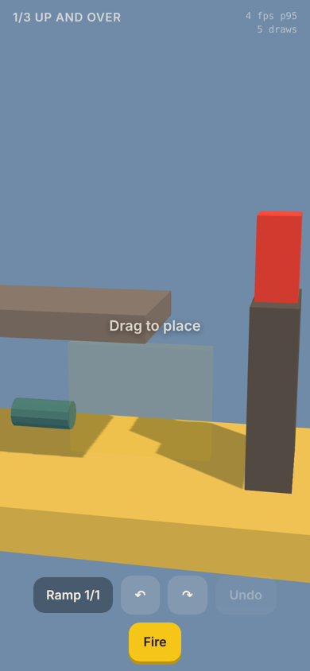

# Chain Wreck

**[Play the vertical slice in your browser](https://emil-eminov.github.io/chain-wreck/)** (3 levels, built for portrait phones)




A mobile-web 3D physics puzzle. Each level puts a target out of direct reach. You place a limited set of trap parts, fire exactly one shot, and the physics plays out as a chain reaction.

This repo is a **killed prototype, kept on purpose.** It was built to a playable gate in about a day, playtested on a real phone, judged boring, and dropped. The engine work, the measurement discipline and the decision record are why it is here. The full write-up is in [`docs/FINDINGS.md`](docs/FINDINGS.md) and the original spec is in [`docs/SPEC.md`](docs/SPEC.md).

## Engineering

| | |
|---|---|
| **Loop** | Fixed-timestep simulation decoupled from rendering, with an explicit phase state machine (survey, build, aim, simulate, result) that throws on any illegal transition |
| **Physics** | Rapier3D (WebAssembly) world with a body factory, confined to a shallow depth slab so a 3D sim reads clearly on a 2D phone screen |
| **Rendering** | Three.js with instanced meshes: 5 draw calls on a real phone at 59 fps |
| **Levels** | JSON level files validated against a schema, plus headless solvability tests that prove every shipped level can actually be won |
| **Testing** | Vitest unit and headless-physics tests; Playwright smoke, screenshot-diff and performance tests |

### Measuring only what can honestly be measured

The cloud test runner has no GPU, so frame times measured there describe a software rasteriser, not the game. The performance budget is split accordingly ([`docs/perf-baseline.md`](docs/perf-baseline.md)):

| Metric | Budget | Measured (80 dynamic bodies) | Asserted in CI |
|---|---|---|---|
| p95 physics step | < 4.0 ms | 0.7 ms | yes |
| Draw calls | < 60 | 2 | yes |
| Real frame rate | 60 fps | 59 fps on a phone | no, read on device |

The first run drew **160 calls for 80 bodies** (one colour pass plus one shadow pass per object). Instancing by primitive shape (one `InstancedMesh` per kind) brought that to 2.

## Why it was killed

Gate A asked one question: is the build-then-destroy loop fun in its minimal form? The playtest verdict was no, and it was the idea, not the execution. Three process lessons carried into the next two concepts, [Rot](https://github.com/emil-eminov/rot) and [Lanista](https://github.com/emil-eminov/lanista):

1. **Gate on fun before content.** One day of work produced a definitive answer that the original plan would have spent eight weeks reaching.
2. **A minimal build cannot test a proposition whose appeal is its payoff.** If the appeal depends on feel, the first playable must include the feel.
3. **Verify the design, not just the code.** Every test passed while the game was boring, and a broken portrait framing shipped in one build without a single failure.

## Run it

```
npm install
npm run dev        # play at the printed localhost URL
npm run verify     # typecheck + lint + unit tests
npm run test:e2e   # Playwright; set CW_CHROMIUM to a Chromium binary
npm run build      # static build in dist/
```

Every push runs `verify` and deploys the build to GitHub Pages.

## Layout

| Path | What lives there |
|---|---|
| `src/core` | Fixed-timestep loop, phase state machine, debug harness |
| `src/physics` | Rapier3D world, body factory, damage |
| `src/render` | Three.js scene, camera, instancing, palette |
| `src/levels` | Level schema, loader and level data |
| `tests` | Vitest unit and headless-physics tests |
| `e2e` | Playwright smoke, screenshot and performance tests |
| `docs` | Spec, findings, performance baseline |

## How this was built

Concept selection, game direction and playtesting by me (Emil Eminov); implementation written with an AI pair-programmer (Claude) to the spec in `docs/`.
